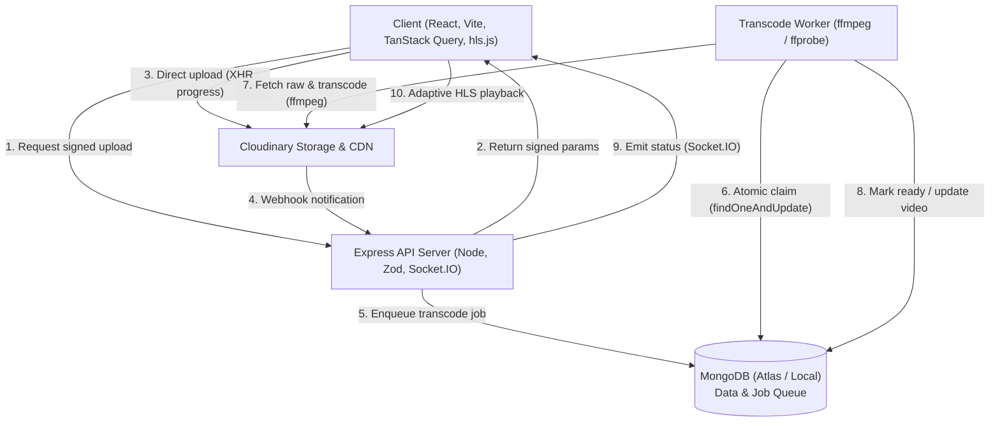

# VidStream

> A video platform where creators upload learning content and project demos transcoded into streamable HLS, and viewers search, watch, react to, and discuss exact moments in a video.

## Problem Statement

Putting video on the web takes far more than an HTML `<video>` tag. Large file uploads, multi-bitrate format conversion, slow-network playback, access control, and discovery require real backend infrastructure. Learners and student creators lack a lightweight platform tailored for educational demos and lecture recaps with discussion tied to exact timestamps.

## Target Users

- **Creators:** Students, instructors, and developers uploading lecture recaps, project walkthroughs, and tutorials.
- **Viewers:** Learners searching for topics before exams or assignments, watching with adaptive streaming, and asking questions at specific timestamps.

## Solution

VidStream solves this with:
- **Direct Cloudinary Uploads:** Fast, signed uploads direct from browser to Cloudinary without overloading backend servers.
- **Asynchronous HLS Transcoding:** Background worker processing videos via `ffmpeg` into multi-rendition HLS (360p, 720p) with master playlist generation and thumbnails.
- **Real-Time Job Status:** Live progress updates communicated via Socket.IO so creators know the instant their video is streamable.
- **Timestamped Discussions & Engagement:** Comments linked directly to player timestamps, deduplicated 24h view tracking, and atomic like/dislike reactions.

## Key Features

1. **Account & Channel:** JWT auth, rotating refresh token in httpOnly cookie, channel customization with subscriber counts.
2. **Direct Upload & Studio:** Presigned upload parameters, file validation, live transcoding progress bar, metadata editing, failure retry.
3. **Adaptive Watch Experience:** HLS adaptive playback with manual quality selector, resume position, 24h deduplicated view count.
4. **Interactive Engagement:** 1-level deep nested comments with timestamp seek links, atomic like/dislike counts.
5. **Search & Subscriptions:** Full-text MongoDB search with tag filters and sorting (relevance, newest, most viewed), subscriptions feed, watch history, and liked videos.

## Tech Stack

- **Frontend:** React 18, Vite, React Router, TanStack Query, Tailwind CSS, hls.js, Socket.IO client, Lucide icons.
- **API & Worker:** Node.js (20+), Express, Socket.IO, Zod, Helmet, Express Rate Limit, Mongoose, fluent-ffmpeg.
- **Database:** MongoDB Atlas with Mongoose (with text indexes, unique compound indexes, and TTL deduplication).
- **Storage & CDN:** Cloudinary with signed direct uploads and webhook notifications.
- **Testing & Quality:** Vitest, Supertest, mongodb-memory-server, ESLint, Prettier.

## Architecture

See [docs/architecture.md](docs/architecture.md) for full architectural documentation.



## Local Setup

### Prerequisites

- Node.js >= 20
- FFmpeg and FFprobe installed (`sudo apt install ffmpeg` or `sudo pacman -S ffmpeg`)
- MongoDB running locally or a MongoDB Atlas URI

### Installation

```bash
git clone https://github.com/Aarav-Sukhadiya/vidstream.git
cd vidstream

# Setup server environment
cp server/.env.example server/.env

# Install dependencies
npm install --prefix server
npm install --prefix client

# Run dev servers
npm run dev --prefix server
npm run dev --prefix client
```

Client runs at `http://localhost:5173` and API runs at `http://localhost:4000`.

## Environment Variables

See [.env.example](.env.example) for the complete list of environment variables.

| Variable | Description | Default |
| --- | --- | --- |
| `PORT` | API server port | `4000` |
| `CLIENT_ORIGIN` | Allowed client CORS origin | `http://localhost:5173` |
| `MONGODB_URI` | MongoDB connection string | `mongodb://localhost:27017/vidstream` |
| `JWT_ACCESS_SECRET` | Secret key for access token signing | - |
| `JWT_REFRESH_SECRET` | Secret key for refresh token signing | - |
| `CLOUDINARY_CLOUD_NAME` | Cloudinary account name | - |
| `CLOUDINARY_API_KEY` | Cloudinary API Key | - |
| `CLOUDINARY_API_SECRET` | Cloudinary API Secret | - |
| `CLOUDINARY_UPLOAD_PRESET`| Cloudinary Upload Preset | `vidstream_raw` |
| `WORKER_MODE` | Transcode worker mode (`inline` or `separate`) | `inline` |
