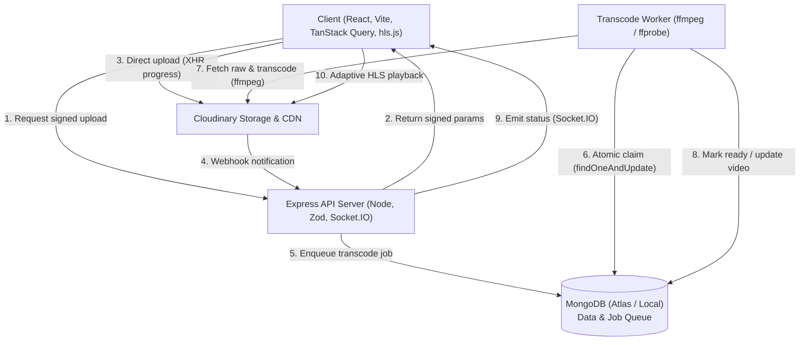

# VidStream

> A high-performance, full-stack video streaming and community platform built with the MERN stack. Creators upload videos directly to cloud storage, background workers transcode media to multi-bitrate HLS, and viewers discover, watch with adaptive bitrate, react atomically, and engage through timestamp-linked discussions.

---

## 1. Problem Statement

Putting video on the web requires substantially more than an HTML `<video>` element. Large file uploads, multi-bitrate format conversion, variable-bandwidth playback, granular access controls, view-fraud prevention, and context-specific discussions demand robust distributed infrastructure.

Learners and student creators have no lightweight place to share videos and discuss specific moments. VidStream provides an intuitive, reliable, and production-grade environment built specifically for learning materials, project demonstrations, and moment-by-moment code reviews.

---

## 2. Target Users

- **Maya (Student Creator):** Uploads 10-minute code walkthroughs, lecture reviews, and software demos; needs reliable background processing, live status updates, metadata controls (public, unlisted, private), and visibility into audience engagement.
- **Ravi (Student Learner):** Searches for algorithm explanations before exams; streams smoothly on both slow mobile and high-speed campus networks; seeks directly to timestamps mentioned in questions (e.g. `2:15`); bookmarks favorite videos and tracks watch history.
- **Instructors & Evaluators:** Need an instant, seeded catalog of ready-to-stream videos without waiting for lengthy transcoding queues.

---

## 3. Solution

VidStream solves the challenges of web video with an integrated, layered architecture:
- **Direct-to-Cloud Uploads:** Uploads bypass application API servers entirely using signed Cloudinary parameters, preventing server thread starvation and memory spikes.
- **Resilient MongoDB Task Queue:** A distributed, Mongo-native job queue handles transcoding with atomic claims (`findOneAndUpdate`), 15-minute lock expiries, and exponential retry backoffs without requiring a separate Redis cluster.
- **Adaptive Multi-Rendition HLS:** `ffmpeg` encodes uploads into dual-rendition HLS (360p and 720p) with master playlist generation (`master.m3u8`), enabling seamless adaptive bitrate switching via `hls.js`.
- **Live Processing Updates:** Socket.IO pushes transcoding progress (`queued`, `processing`, `ready`, `failed`) directly to the creator's Studio in real time.
- **Timestamped Community Engagement:** Rich discussions with nested 1-level replies and clickable timestamp links (`2:15`, `0:45`) that seek the video player immediately.
- **Concurrency-Safe Interactions:** Deduplicated 24-hour view counting with IP/User fingerprinting, and atomic like/dislike counts protected against race conditions.

---

## 4. Key Features

| Category | Features |
| --- | --- |
| **Authentication & Profiles** | JWT access tokens (in-memory) + rotating refresh tokens (httpOnly cookie); reuse detection revokes compromised session families; customizable user channels with avatars, bios, and subscriber counts. |
| **Upload & Studio** | Direct signed uploads; XHR progress tracking; live transcode status updates; Studio dashboard with title/description/tag editing, visibility controls (`public`, `unlisted`, `private`), retry on failed jobs, and permanent deletion with cloud asset cleanup. |
| **Watch & Adaptive Streaming** | Multi-bitrate HLS adaptive playback with manual quality selector (Auto, 720p, 360p); resume playback from previous position; 24-hour deduplicated view counting after 30 seconds of active playback. |
| **Social & Engagement** | Atomic likes and dislikes; threaded comments (1 level deep) with timestamp seeking; rate-limited to 10 comments/min per user (11th returns 429). |
| **Discovery & Search** | Full-text MongoDB search weighted (`title: 10`, `tags: 5`, `description: 1`); safe regex character parsing (`q=a(b`); category tag filtering; sorting by `relevance`, `newest`, and `views`; cursor-based pagination. |
| **Personal Library** | Subscriptions feed aggregating uploads from subscribed channels; channel subscription toggle; watch history with progress bar overlays and one-click clear; liked videos feed. |
| **Hardening & Resilience** | React Error Boundaries; offline detection with manual retry buttons across all pages; actionable empty states; Helmet security headers; MongoDB query sanitisation against operator injection. |

---

## 5. Tech Stack

- **Frontend:** React 18, Vite, React Router 6, TanStack Query (React Query), Tailwind CSS, `hls.js`, Socket.IO client, Lucide React.
- **Backend API:** Node.js 20, Express, Socket.IO, Zod validation, Helmet, `express-rate-limit`, `cookie-parser`, `bcryptjs`.
- **Worker & Transcoding:** `fluent-ffmpeg`, `ffprobe`, Node.js child processes, MongoDB job collection.
- **Database:** MongoDB Atlas / MongoDB 7.0 with Mongoose (text search indexes, compound unique constraints, 24-hour TTL indexes).
- **Storage & CDN:** Cloudinary (signed direct uploads, secure webhook callbacks, CDN media delivery).
- **Testing & Quality:** Vitest, Supertest, ESLint, Prettier, GitHub Actions CI, Gitleaks.
- **Deployment:** Docker (multi-stage build), Render (Express API + WebSockets + inline worker), Vercel (Frontend SPA).

---

## 6. Architecture

For full technical specifications, design patterns, and engineering trade-offs, see [docs/architecture.md](docs/architecture.md).



---

## 7. API Reference

VidStream provides a fully documented REST and WebSocket API. See [docs/api.md](docs/api.md) for endpoint specifications, request bodies, query parameters, responses, and error codes.

---

## 8. Local Setup

### Prerequisites
- Node.js >= 20.x
- FFmpeg and FFprobe installed (`sudo apt install ffmpeg` or `sudo pacman -S ffmpeg` or `brew install ffmpeg`)
- Docker (optional, for local MongoDB container)

### Step-by-Step Installation

```bash
# 1. Clone repository
git clone https://github.com/Aarav-Sukhadiya/vidstream.git
cd vidstream

# 2. Configure environment
cp .env.example server/.env

# 3. Start local MongoDB (if not using MongoDB Atlas)
docker run -d --name vidstream-mongo -p 27017:27017 mongo:7

# 4. Install dependencies
npm install --prefix server
npm install --prefix client

# 5. Seed database with demo users, 16 ready videos, comments, and subscriptions
npm run seed --prefix server

# 6. Start development servers
npm run dev --prefix server   # Starts Express API & Socket.IO on http://localhost:4000
npm run dev --prefix client   # Starts Vite React dev server on http://localhost:5173
```

Visit `http://localhost:5173` to explore VidStream.

---

## 9. Environment Variables

| Variable | Description | Default / Example |
| --- | --- | --- |
| `PORT` | API server listening port | `4000` |
| `CLIENT_ORIGIN` | Allowed client origin for CORS | `http://localhost:5173` |
| `MONGODB_URI` | MongoDB connection URI | `mongodb://localhost:27017/vidstream` |
| `JWT_ACCESS_SECRET` | Secret key for signing access JWTs | `your_access_secret_key` |
| `JWT_REFRESH_SECRET` | Secret key for signing refresh JWTs | `your_refresh_secret_key` |
| `CLOUDINARY_CLOUD_NAME` | Cloudinary account cloud name | `your_cloud_name` |
| `CLOUDINARY_API_KEY` | Cloudinary API Key | `your_api_key` |
| `CLOUDINARY_API_SECRET` | Cloudinary API Secret | `your_api_secret` |
| `CLOUDINARY_UPLOAD_PRESET`| Cloudinary unsigned/signed preset | `vidstream_raw` |
| `WORKER_MODE` | Transcoding worker mode (`inline` or `separate`) | `inline` |

---

## 10. Demo Credentials

The database seed command (`npm run seed --prefix server`) provisions three pre-configured accounts:

| Email | Password | Handle | Role | Bio |
| --- | --- | --- | --- | --- |
| `maya@vidstream.com` | `Password123!` | `maya` | Creator | Full-stack engineer building distributed systems and teaching DSA. |
| `alex@vidstream.com` | `Password123!` | `alex_dev` | Creator | Frontend architecture, modern CSS layouts, and UI performance. |
| `sam@vidstream.com` | `Password123!` | `sam_systems` | Creator | DevOps, Kubernetes orchestration, and database scaling. |

*Note: All 16 seeded videos, subscriptions, timestamped comments, and likes are automatically linked across these accounts.*

---

## 11. Demo Script (4 Minutes)

| Timestamp | Screen | Action & Narration |
| --- | --- | --- |
| **0:00 - 0:30** | Home Page | Introduce VidStream: "A community platform for learners and creators to share video and discuss exact moments." Highlight the responsive 1-to-4 column grid, instant thumbnail loading, duration badges, and channel avatars. |
| **0:30 - 1:30** | Studio Upload | Log in as `maya@vidstream.com`. Navigate to Studio, initiate an upload with a short clip. Show the signed direct upload progress bar, followed by real-time Socket.IO status transitions: `queued` &rarr; `processing` &rarr; `ready`. |
| **1:30 - 2:30** | Watch Page | Open the uploaded video or "Binary Search Trees". Demonstrate adaptive HLS streaming and the manual quality switcher (360p / 720p). Click a like (optimistic UI increment). Show comments: click timestamp `2:15` to see the player seek instantly. Reload page to demonstrate playback position resume. |
| **2:30 - 3:15** | Discovery & Library | Search for `Quantum Computing` (title matches rank above description matches). Filter by tag `dsa`. Open Maya's channel profile and toggle Subscribe. Visit `/subscriptions` to view the unified subscribed feed. Visit `/history` to show the red progress bar and test "Clear All History". |
| **3:15 - 3:45** | Resilience & Edge Cases | Simulate offline in DevTools: show clean error banner with "Retry" button. Post comments rapidly to trigger the 429 rate limit banner on the 11th comment. Show Studio retry for failed jobs. |
| **3:45 - 4:00** | Architecture | Review `docs/architecture.md` diagram and 25-checkpoint conventional commit history. |

---

## 12. Deployment

### Docker Deployment (Single Container)

A production Dockerfile is included at the project root (`Dockerfile`) using Node 20-slim with FFmpeg installed.

```bash
# Build the production image
docker build -t vidstream .

# Run container on port 4000
docker run -d --name vidstream-live -p 4000:4000 --env-file server/.env vidstream
```

### Cloud Deployment Strategy
- **Frontend SPA:** Deploy `client` to Vercel with a rewrite rule (`vercel.json`) routing `/api/*` to the Render backend host to keep the refresh cookie first-party.
- **Backend & Inline Worker:** Deploy Docker container to Render Web Service with `WORKER_MODE=inline`.
- **Database:** MongoDB Atlas (M0 Free Tier or higher) with network access configured.

---

## 13. Known Limitations & Trade-offs

1. **Cold Starts on Free Tier Hosts:** Free Render or container tiers may experience a 30–50 second spin-up latency on the initial request. `/api/health` acts as a keep-alive probe.
2. **Comment Nesting Depth:** Comments support 1-level deep threading (parent and replies). Replying to an existing reply attaches to the top-level parent comment to prevent unreadable indentation cascades on mobile viewports.
3. **Single-Worker Transcoding Throughput:** In default `WORKER_MODE=inline`, transcoding runs as an `ffmpeg` child process on the API container. In high-traffic production environments, setting `WORKER_MODE=separate` on dedicated worker nodes is recommended.
