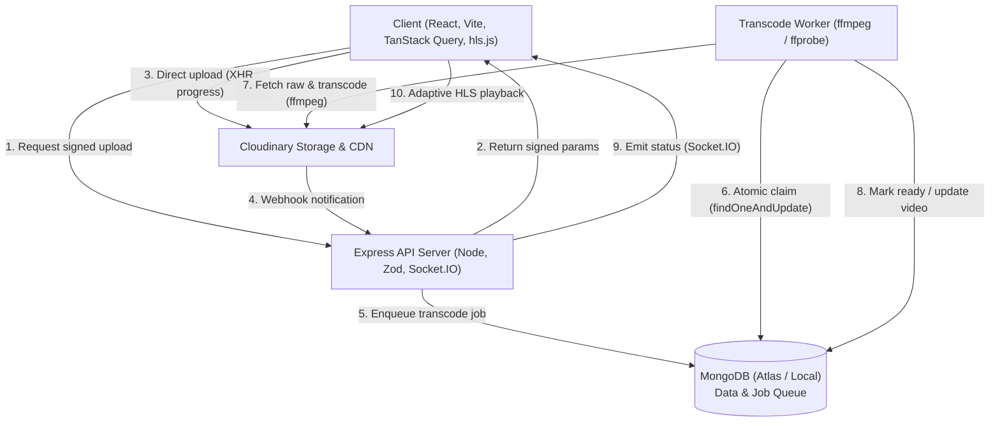

# VidStream Architecture

VidStream is built as a modular MERN architecture with direct-to-cloud uploads, an asynchronous MongoDB-backed job queue, and real-time updates over Socket.IO.

## Core Decisions

1. **Direct Signed Uploads:** Video files bypass the Node API completely during upload, eliminating API memory pressure and request timeouts on large files.
2. **MongoDB Job Queue:** Transcoding jobs are managed directly in a `jobs` collection with atomic `findOneAndUpdate` claims, retry counters, exponential backoff, and 15-minute lock timeouts. This avoids adding a Redis/BullMQ service dependency.
3. **Adaptive HLS Transcoding:** `ffmpeg` generates 360p and 720p renditions with a master playlist (`master.m3u8`), enabling smooth bitrate adaptation in `hls.js`.
4. **Deduplicated Counters:** Views use a 24-hour TTL `ViewEvent` collection keyed by IP/UserAgent/User to prevent inflation. Reactions and subscriptions use atomic `$inc` with unique indexes to prevent race conditions.
