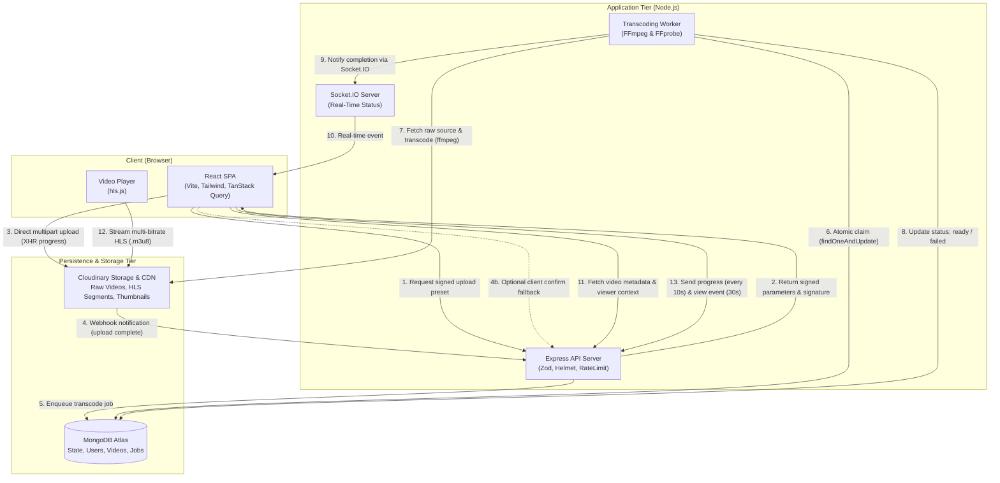

# VidStream Architecture & Technical Decisions

VidStream is built as an end-to-end video streaming and community platform adhering to modern web architecture principles: direct-to-cloud uploads, an asynchronous MongoDB-backed job queue, real-time WebSocket notifications, and multi-bitrate HLS streaming.

---

## 1. High-Level Architecture Diagram

---

## 2. Core Architectural & Technical Decisions

### Decision 1: Direct Signed Uploads vs. API Proxy
- **Context:** Video uploads often exceed 100MB–1GB. Routing large video payloads through Node.js Express servers causes memory spikes, blocks event loops, saturates container bandwidth, and triggers HTTP request timeouts on slow client connections.
- **Decision:** Use signed direct-to-cloud uploads to Cloudinary. The client requests a signed upload signature from `/api/videos`, then streams the binary directly from the browser to Cloudinary via `XMLHttpRequest` with native upload progress.
- **Result:** Node.js memory footprint remains near baseline (< 80MB) regardless of upload file size or network speed.

### Decision 2: MongoDB-Backed Job Queue vs. Redis/BullMQ
- **Context:** Background transcoding requires atomic job claims, retry backoff, and recovery from worker crashes. Introducing Redis + BullMQ adds an operational dependency, additional networking cost, and extra monitoring complexity for a lean deployment.
- **Decision:** Implement a MongoDB-native job queue directly in the `jobs` collection using atomic `findOneAndUpdate`:
  - **Atomic Claiming:** Atomically transitions status from `queued` to `processing` with a lock lease (`lockedAt`, `lockedBy`, and 15-minute lock expiration).
  - **Stale Job Requeuing:** Any job whose lock expired past 15 minutes is automatically reclaimed.
  - **Exponential Backoff & Retries:** Failed jobs increment `attempts`. If `attempts < maxAttempts (3)`, status reverts to `queued` with backoff; otherwise transitions to `failed` with a sanitized `error` message.
  - **Single Dependency:** MongoDB serves both as the primary database and the resilient distributed task queue.

### Decision 3: Adaptive Multi-Bitrate HLS Transcoding
- **Context:** Viewers have varying network bandwidths (mobile LTE, broadband) and screen resolutions. Single MP4 files either buffer indefinitely on weak connections or look pixelated on desktop screens.
- **Decision:** Transcode video into multi-rendition HTTP Live Streaming (HLS) with `ffmpeg`:
  - **Audio Validation:** `ffprobe` validates container validity, codec profiles, and presence of audio tracks.
  - **Multi-bitrate Renditions:**
    - 360p: 640x360 @ 800 kbps (optimized for mobile / constrained networks)
    - 720p: 1280x720 @ 2500 kbps (optimized for HD viewing)
  - **Master Playlist (`master.m3u8`):** Defines stream variants and bandwidth tags.
  - **Client Player:** `hls.js` automatically adapts quality in real-time based on measured segment download speed while offering manual quality overrides.

### Decision 4: 24-Hour Deduplicated View Counting
- **Context:** Naive view counters increment on every HTTP GET or page load, enabling easy view-botting and skewing popularity metrics.
- **Decision:** Enforce view deduplication:
  - **Playback Threshold:** The client player only fires `/api/videos/:id/view` after accumulating 30 seconds of active playback (or 50% of duration for videos shorter than 30s). Paused time is strictly excluded.
  - **Fingerprint Identity:** For authenticated users, the unique key is `user_id + video_id`. For guests, a SHA-256 hash of `IP + UserAgent + ServerSalt` is generated.
  - **Idempotent Storage:** A dedicated `ViewEvent` collection has a unique compound index `{ key: 1, video: 1 }` with a 24-hour TTL index. Duplicate views hit a MongoDB E11000 error, resulting in `{ counted: false }` with zero counter increments.

### Decision 5: Atomic Reactions & Concurrency Safety
- **Context:** Users rapidly toggling likes/dislikes or concurrent requests can corrupt counter caches (`likeCount`, `dislikeCount`) if read-modify-write patterns are used.
- **Decision:** A `reactions` collection with a unique compound index `{ user: 1, video: 1 }` stores the user's state (`1` = like, `-1` = dislike). Toggling executes an atomic `findOneAndUpdate` with `upsert: true`, comparing the previous document state to calculate exact `$inc` deltas for `likeCount` and `dislikeCount` in one atomic operation.

### Decision 6: Token Family Rotation & Reuse Detection
- **Context:** Storing JWT access tokens in localStorage exposes them to XSS attacks. Long-lived refresh tokens without rotation allow persistent stolen-session abuse.
- **Decision:** Implement strict token family rotation:
  - **Access Token:** Short-lived (15 minutes), delivered in memory.
  - **Refresh Token:** Cryptographically strong random string stored in an `httpOnly`, `SameSite: Lax`, `Secure` cookie.
  - **Rotation:** Each `/api/auth/refresh` rotates both the access token and the refresh token cookie.
  - **Reuse Detection:** If an already-rotated or revoked refresh token is submitted, the server detects token replay, revokes all active sessions for that user family, and returns 401 `UNAUTHENTICATED`.

### Decision 7: Defensive Hardening & Graceful Degradation
- **Helmet:** Applies `Content-Security-Policy`, `X-Content-Type-Options: nosniff`, and `Cross-Origin-Resource-Policy: cross-origin`.
- **Sanitisation:** Recursive middleware strips keys starting with `$` or containing `.` to prevent MongoDB operator injection.
- **Rate Limiting:** IP and user-based limits: 10 comments/min (11th returns 429), 20 auth attempts/15min, 300 api requests/15min.
- **Error Boundaries & Offline Handling:** React Error Boundary wraps the UI with actionable retry buttons and clear empty states across all pages.
